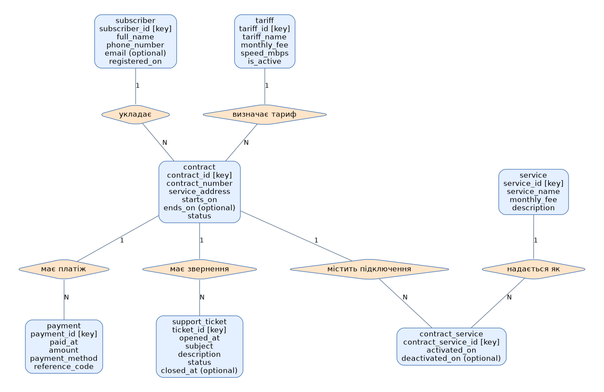

# Лабораторна робота №2
## Концептуальна та логічна модель: telecom_operator

### Мета
Проаналізувати предметну область, визначити інформаційні об’єкти, атрибути, зв’язки та побудувати концептуальну й логічну модель.

### 1. Опис предметної області
Система призначена для оператора фіксованого інтернету. Менеджер веде абонентів і договори, бухгалтер переглядає платежі, служба підтримки опрацьовує звернення. Абонент може мати кілька договорів за різними адресами. Договір використовує один поточний тариф. Додаткові послуги підключаються на окремі періоди. Облік мережевого обладнання, трафіку, рахунків-нарахувань і версій тарифів не входить до меж моделі.

### 2. Інформаційні потреби
1. Які активні договори має абонент?
2. Який тариф і адреса обслуговування кожного договору?
3. Які додаткові послуги підключені зараз та були підключені раніше?
4. Які платежі надійшли за договором за період?
5. Які відкриті звернення потребують опрацювання?
6. Яка поточна місячна вартість тарифу та активних додаткових послуг?

### 3. Інформаційні об’єкти та всі атрибути
| Сутність | Атрибути |
|---|---|
| subscriber | subscriber_id **PK**, full_name, phone_number, email (необов’язкове), registered_on |
| tariff | tariff_id **PK**, tariff_name, monthly_fee, speed_mbps, is_active |
| contract | contract_id **PK**, subscriber_id, tariff_id, contract_number, service_address, starts_on, ends_on (необов’язкове), status |
| service | service_id **PK**, service_name, monthly_fee, description |
| contract_service | contract_service_id **PK**, contract_id, service_id, activated_on, deactivated_on (необов’язкове) |
| payment | payment_id **PK**, contract_id, paid_at, amount, payment_method, reference_code |
| support_ticket | ticket_id **PK**, contract_id, opened_at, subject, description, status, closed_at (необов’язкове) |

### 4. Концептуальна ER-модель


[Редагована діаграма draw.io](telecom_conceptual.drawio)

Прямокутники — сутності; ромби — названі зв’язки; атрибути наведено всередині сутностей. Позначення key — ідентифікатор; optional — необов’язкове поле. FK на концептуальному рівні представлені зв’язками, а в повному переліку атрибутів і логічній схемі вказані явно. Числа 1 та N показують максимальну кратність.

### 5. Зв’язки та обов’язковість участі
| Зв’язок | Кратність та участь |
|---|---|
| subscriber → contract (subscriber_id) | 1:N; у батьківського запису 0..N дочірніх; у дочірнього рівно 1 батьківський |
| tariff → contract (tariff_id) | 1:N; у батьківського запису 0..N дочірніх; у дочірнього рівно 1 батьківський |
| contract → contract_service (contract_id) | 1:N; у батьківського запису 0..N дочірніх; у дочірнього рівно 1 батьківський |
| service → contract_service (service_id) | 1:N; у батьківського запису 0..N дочірніх; у дочірнього рівно 1 батьківський |
| contract → payment (contract_id) | 1:N; у батьківського запису 0..N дочірніх; у дочірнього рівно 1 батьківський |
| contract → support_ticket (contract_id) | 1:N; у батьківського запису 0..N дочірніх; у дочірнього рівно 1 батьківський |

### 6. Логічна схема
```text
subscriber (subscriber_id PK, full_name, phone_number, email, registered_on)
tariff (tariff_id PK, tariff_name, monthly_fee, speed_mbps, is_active)
contract (contract_id PK, subscriber_id FK, tariff_id FK, contract_number, service_address, starts_on, ends_on, status)
service (service_id PK, service_name, monthly_fee, description)
contract_service (contract_service_id PK, contract_id FK, service_id FK, activated_on, deactivated_on)
payment (payment_id PK, contract_id FK, paid_at, amount, payment_method, reference_code)
support_ticket (ticket_id PK, contract_id FK, opened_at, subject, description, status, closed_at)
```

PK — первинний ключ; FK — зовнішній ключ. Залежності FK наведено в таблиці зв’язків. Об’єкти мають окремі ідентифікатори; неключові атрибути описують відповідний об’єкт. Обрані унікальні поля та складені обмеження перелічено в ЛР №3.

### 7. Обмеження і припущення
Телефон абонента, номер договору, назва тарифу, назва послуги та код платежу унікальні в межах відповідної таблиці. Email, дати завершення і закриття можуть бути відсутні. Дати завершення не передують початку. Суми тарифів і послуг невід’ємні; платіж додатний. Швидкість додатна. Закрите звернення обов’язково має дату закриття. Один рядок contract_service описує один період підключення. Зв’язок contract–service має кратність M:N і розв’язується асоціативною сутністю contract_service. Повторне підключення дозволено в іншу дату. Перетин періодів тієї самої послуги за одним договором має перевіряти застосунок; DDL цього не гарантує. Тарифні ціни зберігаються як поточні; обчислити історичну заборгованість без нарахувань і версій цін неможливо.

### 8. Висновок
Виділено 7 інформаційних об’єктів і визначено їхні атрибути та зв’язки. Побудовано концептуальну ER-модель і логічну схему для подальшої реалізації у MySQL.

Джерело завдання: надана методичка Lab 2(1).pdf, розділ «Домашнє завдання».
