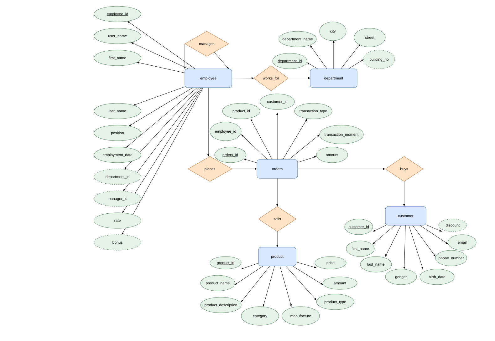

# Лабораторна робота №2
## Концептуальна та логічна модель: company

### Мета
Проаналізувати предметну область, визначити інформаційні об’єкти, атрибути, зв’язки та побудувати концептуальну й логічну модель.

### 1. Опис предметної області
База даних компанії з продажу комп’ютерної техніки зберігає представництва, працівників, клієнтів, товари та продажі. Кожний продаж описує один товар, одного покупця і одного продавця. Один багатотоварний чек у цій навчальній моделі не виділяється.

### 2. Інформаційні потреби
1. Перегляд працівників представництва та їхніх керівників.
2. Перегляд клієнтів та знижок.
3. Перевірка залишків товарів.
4. Аналіз продажів товарів і працівників за період.

### 3. Інформаційні об’єкти та всі атрибути
| Сутність | Атрибути |
|---|---|
| department | department_id **PK**, department_name, city, street, building_no (необов’язкове) |
| employee | employee_id **PK**, user_name, first_name, last_name, position, employment_date, department_id (необов’язкове), manager_id (необов’язкове), rate, bonus (необов’язкове) |
| customer | customer_id **PK**, first_name, last_name, genger, birth_date, phone_number, email, discount (необов’язкове) |
| product | product_id **PK**, product_name, product_description, category, manufacture, product_type, amount, price |
| orders | orders_id **PK**, employee_id, product_id, customer_id, transaction_type, transaction_moment, amount |

### 4. Концептуальна ER-модель


[Редагована діаграма draw.io](Company_ER.drawio)

Прямокутники — сутності, ромби — зв’язки, овали — атрибути; підкреслення — ключ, пунктир — необов’язковість. Точні кратності наведено в таблиці нижче.

### 5. Зв’язки та обов’язковість участі
| Зв’язок | Кратність та участь |
|---|---|
| department → employee (department_id) | 1:N; у батьківського запису 0..N дочірніх; у дочірнього 0..1 батьківський |
| employee → employee (manager_id) | 1:N; у батьківського запису 0..N дочірніх; у дочірнього 0..1 батьківський |
| employee → orders (employee_id) | 1:N; у батьківського запису 0..N дочірніх; у дочірнього рівно 1 батьківський |
| product → orders (product_id) | 1:N; у батьківського запису 0..N дочірніх; у дочірнього рівно 1 батьківський |
| customer → orders (customer_id) | 1:N; у батьківського запису 0..N дочірніх; у дочірнього рівно 1 батьківський |

### 6. Логічна схема
```text
department (department_id PK, department_name, city, street, building_no)
employee (employee_id PK, user_name, first_name, last_name, position, employment_date, department_id FK, manager_id FK, rate, bonus)
customer (customer_id PK, first_name, last_name, genger, birth_date, phone_number, email, discount)
product (product_id PK, product_name, product_description, category, manufacture, product_type, amount, price)
orders (orders_id PK, employee_id FK, product_id FK, customer_id FK, transaction_type, transaction_moment, amount)
```

PK — первинний ключ; FK — зовнішній ключ. Залежності FK наведено в таблиці зв’язків. Об’єкти мають окремі ідентифікатори; неключові атрибути описують відповідний об’єкт. Обрані унікальні поля та складені обмеження перелічено в ЛР №3.

### 7. Обмеження і припущення
Збережено назви `genger` і `manufacture` з методички. У department, employee, customer, product, orders відповідно 5, 10, 8, 8, 7 полів. Максимальна кратність усіх зв’язків — 1:N, включно з рекурсивним зв’язком керівник–підлеглі. Працівник може не мати керівника або представництва. Необов’язкові building_no, discount і bonus. Керівник не повинен бути власним підлеглим; цикли ієрархії перевіряє застосунок. У логічній схемі зв’язки реалізуються FK, позначеними нижче.

### 8. Висновок
Виділено 5 інформаційних об’єктів і визначено їхні атрибути та зв’язки. Побудовано концептуальну ER-модель і логічну схему для подальшої реалізації у MySQL.

Джерело завдання: надана методичка Lab 2(1).pdf, розділ «Домашнє завдання».
