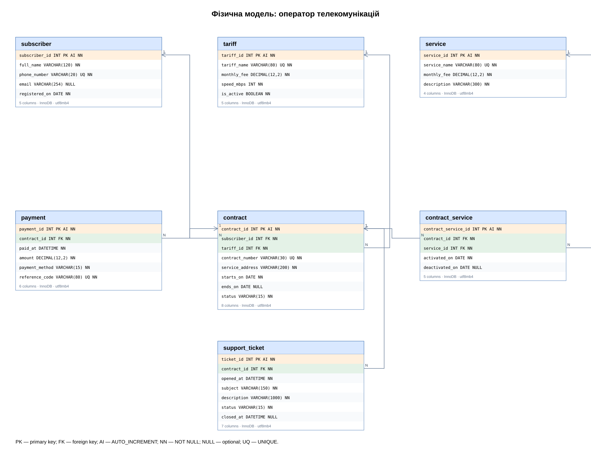

# Лабораторна робота №3
## Фізична модель: оператор телекомунікацій

### Мета
Перетворити логічну модель ЛР №2 у таблиці з типами, ключами та обмеженнями; підготувати SQL-скрипт.

### Фізична діаграма


[Редагований draw.io](telecom_operator_physical.drawio) · [Створення бази SQL](telecom_operator.sql) · [Тестові дані](demo_data.sql) · [Запити](queries.sql)

PK — первинний ключ; FK — зовнішній ключ; NN — NOT NULL; AI — AUTO_INCREMENT; UQ — UNIQUE. NULL позначає необов’язкове поле.

### СУБД та типи
MySQL 8.0.16+ / InnoDB / utf8mb4. INT — ідентифікатори і швидкість; VARCHAR — тексти та телефони; DECIMAL — суми в гривнях; DATE — дати; DATETIME — дата й час (домовленість: UTC). BOOLEAN у MySQL реалізується через TINYINT; CHECK обмежує значення 0/1. Часові дані вводяться застосунком.

### Повний словник даних
| Таблиця | Поле | Тип | Ключ | Обмеження |
|---|---|---|---|---|
| subscriber | subscriber_id | INT | PK  | NOT NULL AUTO_INCREMENT |
| subscriber | full_name | VARCHAR(120) |  | NOT NULL |
| subscriber | phone_number | VARCHAR(20) |  | NOT NULL |
| subscriber | email | VARCHAR(254) |  | NULL |
| subscriber | registered_on | DATE |  | NOT NULL |
| tariff | tariff_id | INT | PK  | NOT NULL AUTO_INCREMENT |
| tariff | tariff_name | VARCHAR(80) |  | NOT NULL |
| tariff | monthly_fee | DECIMAL(12,2) |  | NOT NULL |
| tariff | speed_mbps | INT |  | NOT NULL |
| tariff | is_active | BOOLEAN |  | NOT NULL DEFAULT TRUE |
| contract | contract_id | INT | PK  | NOT NULL AUTO_INCREMENT |
| contract | subscriber_id | INT | FK | NOT NULL |
| contract | tariff_id | INT | FK | NOT NULL |
| contract | contract_number | VARCHAR(30) |  | NOT NULL |
| contract | service_address | VARCHAR(200) |  | NOT NULL |
| contract | starts_on | DATE |  | NOT NULL |
| contract | ends_on | DATE |  | NULL |
| contract | status | VARCHAR(15) |  | NOT NULL DEFAULT 'active' |
| service | service_id | INT | PK  | NOT NULL AUTO_INCREMENT |
| service | service_name | VARCHAR(80) |  | NOT NULL |
| service | monthly_fee | DECIMAL(12,2) |  | NOT NULL |
| service | description | VARCHAR(300) |  | NOT NULL |
| contract_service | contract_service_id | INT | PK  | NOT NULL AUTO_INCREMENT |
| contract_service | contract_id | INT | FK | NOT NULL |
| contract_service | service_id | INT | FK | NOT NULL |
| contract_service | activated_on | DATE |  | NOT NULL |
| contract_service | deactivated_on | DATE |  | NULL |
| payment | payment_id | INT | PK  | NOT NULL AUTO_INCREMENT |
| payment | contract_id | INT | FK | NOT NULL |
| payment | paid_at | DATETIME |  | NOT NULL |
| payment | amount | DECIMAL(12,2) |  | NOT NULL |
| payment | payment_method | VARCHAR(15) |  | NOT NULL |
| payment | reference_code | VARCHAR(80) |  | NOT NULL |
| support_ticket | ticket_id | INT | PK  | NOT NULL AUTO_INCREMENT |
| support_ticket | contract_id | INT | FK | NOT NULL |
| support_ticket | opened_at | DATETIME |  | NOT NULL |
| support_ticket | subject | VARCHAR(150) |  | NOT NULL |
| support_ticket | description | VARCHAR(1000) |  | NOT NULL |
| support_ticket | status | VARCHAR(15) |  | NOT NULL DEFAULT 'open' |
| support_ticket | closed_at | DATETIME |  | NULL |

### Ключі й перевірки
| Таблиця | UNIQUE / CHECK |
|---|---|
| subscriber | UNIQUE(phone_number) |
| tariff | UNIQUE(tariff_name); monthly_fee >= 0; speed_mbps > 0; is_active IN (0, 1) |
| contract | UNIQUE(contract_number); ends_on IS NULL OR ends_on >= starts_on; status IN ('active','suspended','closed') |
| service | UNIQUE(service_name); monthly_fee >= 0 |
| contract_service | UNIQUE(contract_id, service_id, activated_on); deactivated_on IS NULL OR deactivated_on >= activated_on |
| payment | UNIQUE(reference_code); amount > 0; payment_method IN ('cash','card','bank_transfer') |
| support_ticket | status IN ('open','in_progress','closed'); closed_at IS NULL OR closed_at >= opened_at; (status = 'closed' AND closed_at IS NOT NULL) OR (status <> 'closed' AND closed_at IS NULL) |

Всі FK мають ON DELETE RESTRICT / ON UPDATE RESTRICT та індекси. Додатковий індекс payment.paid_at прискорює вибірку платежів за часом. Таблиця contract_service перетворює M:N між contract і service на два зв’язки 1:N. Всі інші зв’язки — 1:N.

### Запуск
1. Підключитися до MySQL-сервера у MySQL Workbench.
2. Відкрити telecom_operator.sql через File → Open SQL Script і виконати повністю у новій порожній схемі.
3. За бажанням виконати demo_data.sql (синтетичні навчальні дані).
4. Виконати queries.sql для перегляду договорів, платежів, послуг і звернень.

```sql
USE telecom_operator;
SHOW TABLES;
SHOW CREATE TABLE contract;
```

Скрипт створює базу та 7 таблиць, не містить DROP. Повторний запуск CREATE TABLE у вже заповненій схемі завершиться помилкою. Діаграми й SQL сформовано програмно; вони не є скріншотами або експортом із DBDesigner. Для діаграми у власному середовищі можна використати reverse engineering MySQL Workbench.

### Межі цілісності
FK/UNIQUE/CHECK перевіряють посилання, унікальність, суми, локальні дати і статуси. Відсутність перетинів підключень послуги, коректність реального телефону/email і допустимість операцій із закритим договором перевіряються застосунком. Система обліковує платежі, але не розраховує історичну заборгованість: немає нарахувань і версій цін.

### Перевірка та висновок
Структуру й обмеження перевірено після технічної адаптації DDL на SQLite: 7 коректних вставок пройшли; 6 операцій із порушеннями FK, UNIQUE, CHECK та RESTRICT відхилено. Це не є перевіркою імпорту у MySQL; MySQL-сервер у середовищі не запускався. Фізична схема зберігає всі атрибути логічної моделі та готова для імпорту й перевірки у MySQL.

Джерело вимог: Lab 3(1).pdf, розділ «Домашнє завдання».
