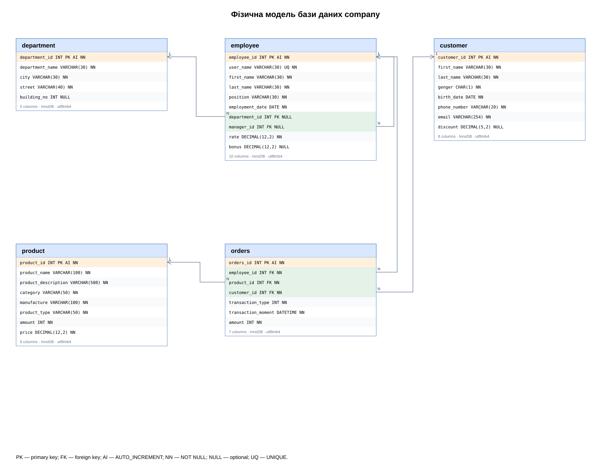

# Лабораторна робота 3
## Фізична модель бази даних company

### Мета
Перетворити логічну модель з лабораторної №2 на фізичну модель: визначити таблиці, типи даних, PK, FK, обов’язковість полів, індекси та створити SQL-скрипт.

### Результат
Створено **5 таблиць**, **38 стовпців** та **5 зовнішніх ключів**. СУБД — MySQL 8.0.16+; рушій InnoDB; кодування utf8mb4; зіставлення utf8mb4_unicode_ci.



[Файл draw.io](company_physical.drawio) · [SQL-скрипт](company.sql) · [DBML-модель](company.dbml)

Діаграма містить усі стовпці, фізичні типи та позначення PK/FK/NN/NULL/AI. Стрілки йдуть від FK до батьківського PK. Для необов’язкового FK батьківський запис може бути відсутній; цифри N і 1 показують максимальну кратність.

### Специфікація стовпців
| Таблиця | Поле | Тип | Ключ | Обов’язковість / значення за замовчуванням |
|---|---|---|---|---|
| department | department_id | INT | PK  | NOT NULL AUTO_INCREMENT |
| department | department_name | VARCHAR(30) |  | NOT NULL |
| department | city | VARCHAR(30) |  | NOT NULL DEFAULT 'Lviv' |
| department | street | VARCHAR(40) |  | NOT NULL |
| department | building_no | INT |  | NULL |
| employee | employee_id | INT | PK  | NOT NULL AUTO_INCREMENT |
| employee | user_name | VARCHAR(30) |  | NOT NULL |
| employee | first_name | VARCHAR(30) |  | NOT NULL |
| employee | last_name | VARCHAR(30) |  | NOT NULL |
| employee | position | VARCHAR(30) |  | NOT NULL |
| employee | employment_date | DATE |  | NOT NULL |
| employee | department_id | INT | FK  | NULL |
| employee | manager_id | INT | FK  | NULL |
| employee | rate | DECIMAL(12,2) |  | NOT NULL |
| employee | bonus | DECIMAL(12,2) |  | NULL |
| customer | customer_id | INT | PK  | NOT NULL AUTO_INCREMENT |
| customer | first_name | VARCHAR(30) |  | NOT NULL |
| customer | last_name | VARCHAR(30) |  | NOT NULL |
| customer | genger | CHAR(1) |  | NOT NULL |
| customer | birth_date | DATE |  | NOT NULL |
| customer | phone_number | VARCHAR(20) |  | NOT NULL |
| customer | email | VARCHAR(254) |  | NOT NULL |
| customer | discount | DECIMAL(5,2) |  | NULL |
| product | product_id | INT | PK  | NOT NULL AUTO_INCREMENT |
| product | product_name | VARCHAR(100) |  | NOT NULL |
| product | product_description | VARCHAR(500) |  | NOT NULL |
| product | category | VARCHAR(50) |  | NOT NULL |
| product | manufacture | VARCHAR(100) |  | NOT NULL |
| product | product_type | VARCHAR(50) |  | NOT NULL |
| product | amount | INT |  | NOT NULL DEFAULT 0 |
| product | price | DECIMAL(12,2) |  | NOT NULL |
| orders | orders_id | INT | PK  | NOT NULL AUTO_INCREMENT |
| orders | employee_id | INT | FK  | NOT NULL |
| orders | product_id | INT | FK  | NOT NULL |
| orders | customer_id | INT | FK  | NOT NULL |
| orders | transaction_type | INT |  | NOT NULL |
| orders | transaction_moment | DATETIME |  | NOT NULL |
| orders | amount | INT |  | NOT NULL |

### Зовнішні ключі
| Зовнішній ключ | Батьківський ключ | Видалення / оновлення |
|---|---|---|
| employee.department_id | department.department_id | RESTRICT / RESTRICT |
| employee.manager_id | employee.employee_id | RESTRICT / RESTRICT |
| orders.employee_id | employee.employee_id | RESTRICT / RESTRICT |
| orders.product_id | product.product_id | RESTRICT / RESTRICT |
| orders.customer_id | customer.customer_id | RESTRICT / RESTRICT |

### Запуск скрипту
1. Відкрийте MySQL Workbench і підключіться до свого MySQL-сервера.
2. Виберіть File → Open SQL Script та відкрийте `company.sql`.
3. Запустіть скрипт повністю. Він створить базу `company` та її таблиці.
4. Оновіть SCHEMAS. Для перевірки виконайте:

```sql
USE company;
SHOW TABLES;
SHOW CREATE TABLE `orders`;
```

Скрипт призначений для першого запуску у порожній схемі. Він не видаляє дані та не змінює існуючі таблиці. Повторне виконання CREATE TABLE для існуючої таблиці завершиться помилкою; для повторного запуску використайте іншу порожню схему.

Для отримання діаграми у власному середовищі виконайте reverse engineering створеної схеми у MySQL Workbench. До комплекту вже додано редаговану діаграму draw.io. Файли сформовано програмно; це не скріншоти DBDesigner і не експорт із нього. SQL є основним джерелом визначень; DBML — додатковий формат із типами та зв’язками, без дублювання всіх CHECK та DEFAULT.

### Чому обрано ці типи
INT використано для сумісних PK та FK. VARCHAR — для тексту; DATE — для календарних дат; DATETIME — для дати й часу події. DECIMAL зберігає грошові суми точно. AUTO_INCREMENT генерує сурогатні ідентифікатори; у зв’язувальній таблиці зі складеним PK він не потрібен. FK індексуються явно; UNIQUE та PK також створюють індекси.

### Уточнення до методички
Збережено всі задані назви, включно з `genger` та `manufacture`. Таблиця employee містить 10 атрибутів із початкової моделі. `building_no`, `discount`, `department_id`, `manager_id`, `bonus` допускають NULL. `city` має DEFAULT 'Lviv'.

Замість FLOAT для rate, bonus і price використано DECIMAL(12,2). Номер телефону — VARCHAR(20), щоб зберігати + і початкові нулі; перевірка конкретного телефонного формату залишається на рівні застосунку. Позначення integer(3), integer(12) та integer(2) зі слайда не означають обмеження кількості цифр, тому довжину INT не використано. transaction_type: 1 — готівка, 2 — картка, 3 — банківський переказ. Це навчальний словник кодів.

CHECK обмежують знижку 0–100, невід’ємні ставки, бонуси, ціну і залишки, додатну кількість продажу, номер будинку та значення статі F/M за умовою. Ієрархію керівників без циклів, атомарне зменшення залишків та узгодженість дат повинен забезпечувати застосунок або окремі тригери. Історична ціна продажу в умові відсутня і не додавалася.

### Перевірка і межі перевірки
Таблиці, стовпці, PK і FK зіставлено між SQL та діаграмою. Додатково проведено локальні перевірки обмежень на SQLite після технічного перетворення MySQL DDL; докладні результати містяться у verification.md. MySQL-сервер у робочому середовищі відсутній, тому успішний імпорт саме у MySQL не заявляється. Після імпорту перевірте SHOW TABLES та SHOW CREATE TABLE.

### Висновок
Побудовано фізичну модель з конкретними типами, первинними та зовнішніми ключами. Додано індекси для зв’язків і пошуку за часом, а також обмеження цілісності рівня рядка. SQL-скрипт готовий для першого запуску у порожній схемі MySQL; діаграму можна редагувати у draw.io.

### Джерела
- Надана методичка Lab 3.pdf, слайди 2–4, 12–16.
- [MySQL CREATE TABLE](https://dev.mysql.com/doc/refman/8.4/en/create-table.html).
- [MySQL CHECK constraints](https://dev.mysql.com/doc/refman/8.0/en/create-table-check-constraints.html).

### Завантаження на GitHub
Завантажте весь вміст цієї папки до LAB-3 відповідного репозиторію. README.md, PNG, drawio, DBML та SQL повинні залишатися разом, щоб відносні посилання працювали.
